# Loyalty — a Shopify theme with an AI configurator

A Shopify Online Store 2.0 theme written from scratch, six demo stores built on it, and a configurator
that puts a visitor's own theme together beside a live preview — then builds it as a real, installable
theme. Describe your store in a few words and Claude sets up the first draft.

**Try it:** [Studio, the configurator](https://loyalty-open.onrender.com/studio) ·
demos: [Vital](https://loyalty-open.onrender.com/vital) ·
[Bloom](https://loyalty-open.onrender.com/bloom) ·
[Pure](https://loyalty-open.onrender.com/pure) ·
[Thread](https://loyalty-open.onrender.com/thread) ·
[Lustre](https://loyalty-open.onrender.com/lustre) ·
[Nest](https://loyalty-open.onrender.com/nest)

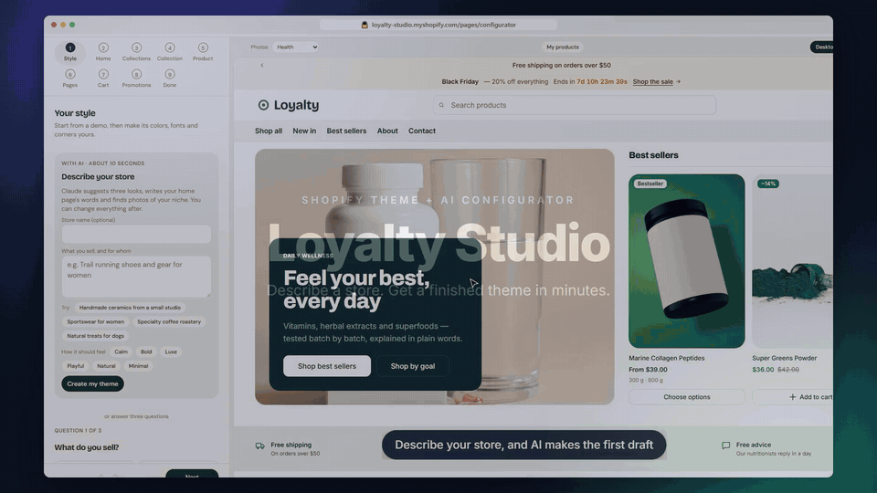

▶ **[Watch the walkthrough (1:46)](media/walkthrough.mp4)**

> The source code is private. It is available on request for a review — get in touch through
> [my GitHub profile](https://github.com/OlehPavlushenko).

## The configurator

Nine steps — style, home page, collections, a collection, the product page, ready pages, cart,
promotions, done. Every change shows at once in a live preview of the store, on desktop or a phone, with
the photos of the visitor's niche or the products of their own Shopify store. The choice lives in a
link, so it can be shared or picked up later; at the end, a build server turns it into a theme zip
that installs in Shopify like any other theme, and stays fully editable in Shopify's theme editor.

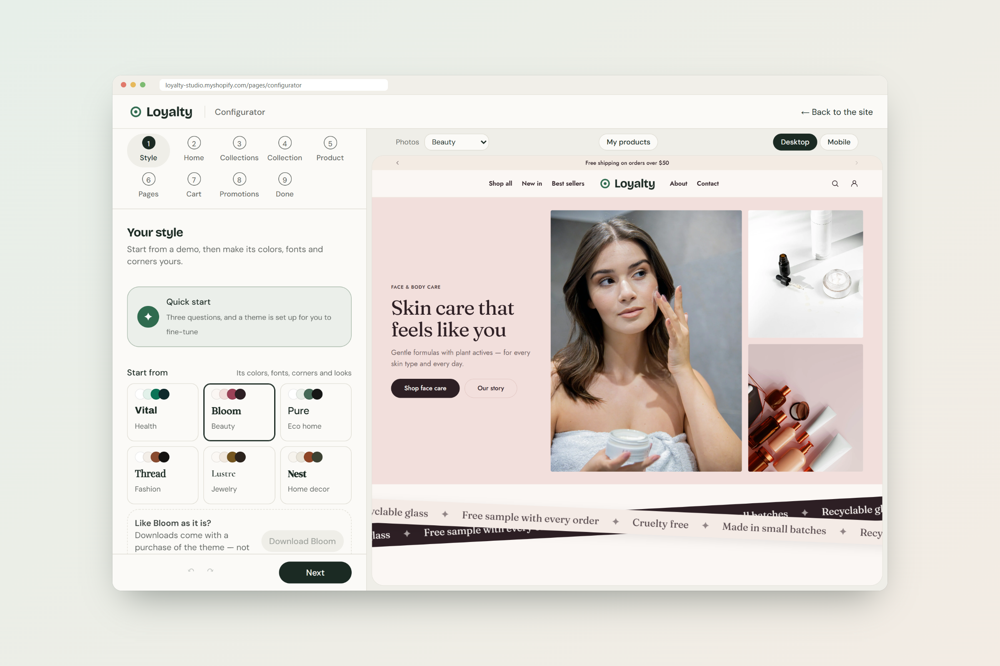

## Describe your store, with Claude

"Handmade ceramics from a small studio" and a feel (calm, bold, luxe…) are enough: Claude suggests three
looks — colors, fonts, corners, a home page layout — writes the home page's words and finds stock photos
of the niche for the preview. The model answers in a structured format limited to the configurator's
own options, so every suggestion can actually be built. The spend is bounded on the server: input cut to
a few hundred characters, a cap per visitor an hour and per day, repeated descriptions answered from a
cache; the API key never reaches the browser.

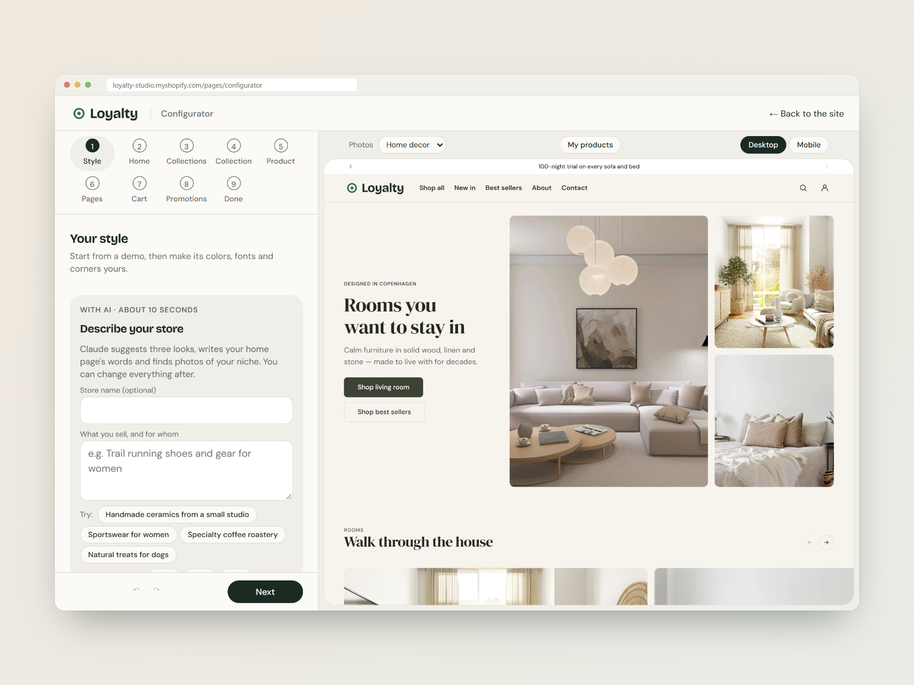

## Built with AI, end to end

The whole product — theme, configurator, build server, demo content — was built solo with
[Claude Code](https://claude.com/claude-code) as the pair programmer. What made that work at this size:

- **Written rules the agent follows.** The architecture (how sections and their views are organized, how
  presets are built), naming, comments and the rules for live stores live in the repo as a project brief
  the agent reads first, so hundreds of sessions produce one consistent codebase.
- **Custom skills for the repeated work:** *ship* (build, Theme Check, commit, push to the six demo stores,
  rebuild Studio), *visual review* (Playwright screenshots of every variant on desktop and phone, with
  automatic flags for JS errors, overflow, broken images and half-empty grid rows) and *merchant UX* (walk
  the configurator and the theme editor as a store owner, then propose and fix).
- **A reviewer agent** that checks each diff against the architecture rules, alongside a bug-hunting
  code review.
- **Code that fills the stores:** products, collections, pages, reviews and photos of six niches go into
  Shopify development stores through the Admin API, so a demo can be rebuilt from scratch.
- **This video** is generated too: a script drives the configurator in Chrome, records it over CDP, and
  edits it with ffmpeg — camera zooms, captions, title cards and music.

## The theme

- About 70 sections; 12 components with switchable views (headers, heroes, product cards, product pages,
  collection grids, cart drawers, footers…), each view loaded only where it's used
- 11 storefront languages
- Built-in selling features: quick view, wishlist, compare, filters, bundles, quantity breaks, frequently
  bought together, a free-shipping bar, promo popups and countdowns
- No apps or servers required for any feature; no UI framework — plain SCSS, ES modules and web
  components, minified, with only what a page uses loaded
- Works with real apps: a demo store runs Judge.me reviews, Klaviyo and Shopify Subscriptions

| | |
|---|---|
| 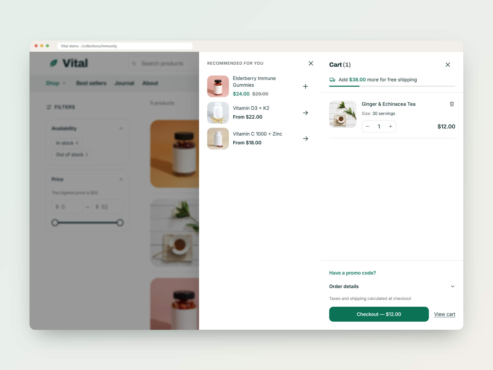 | 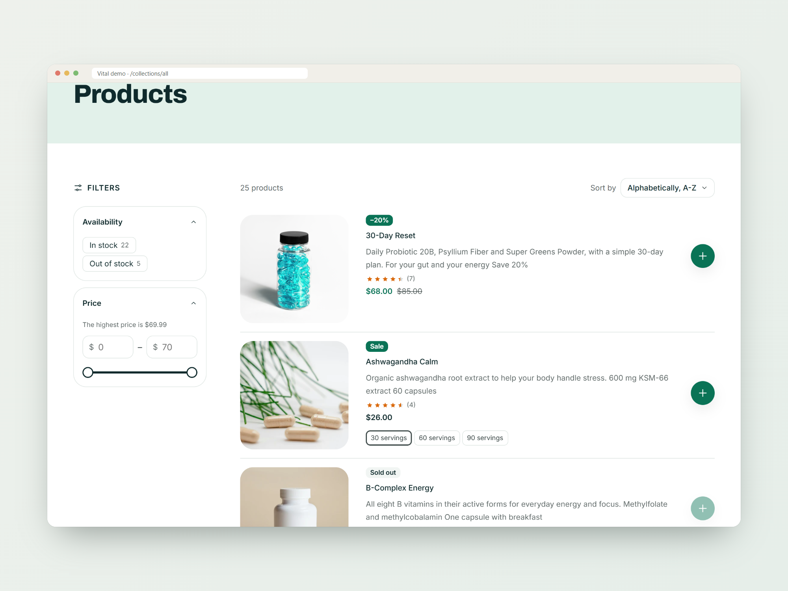 |
| 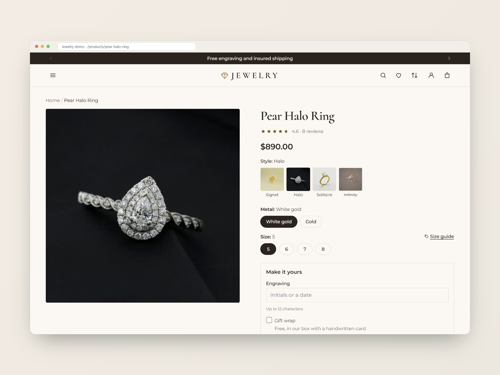 | 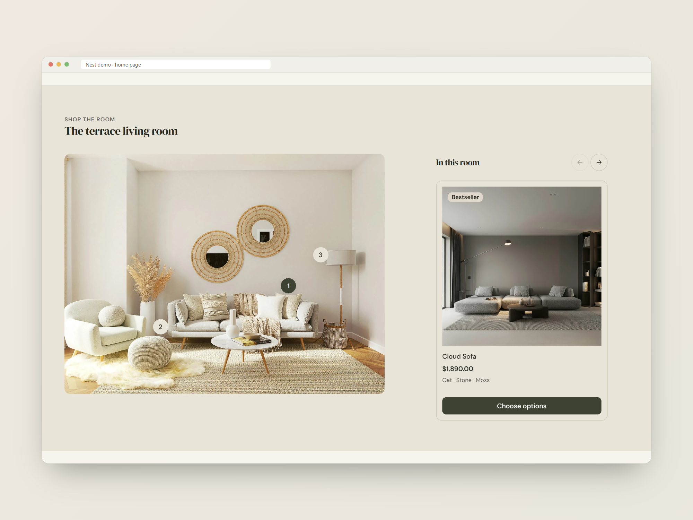 |

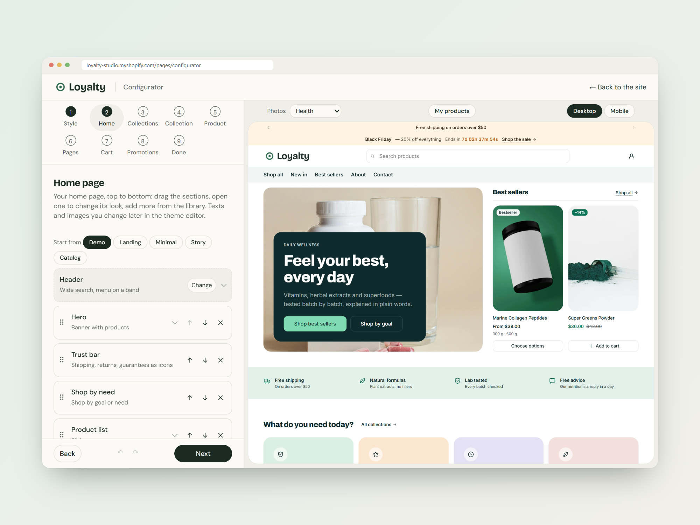

## Six demo stores

Each demo is a niche with its own look, catalog of fictional brands and stock photos, filled into a
Shopify development store from code.

| | | |
|---|---|---|
|  Vital — health |  Bloom — beauty | 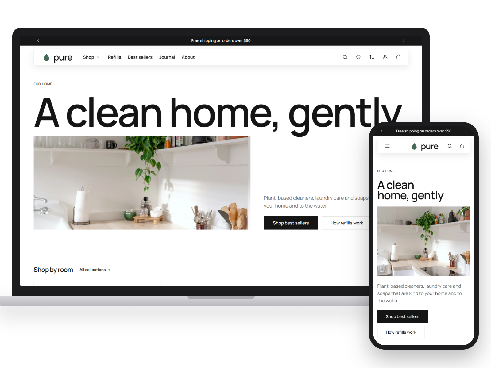 Pure — eco home |
| 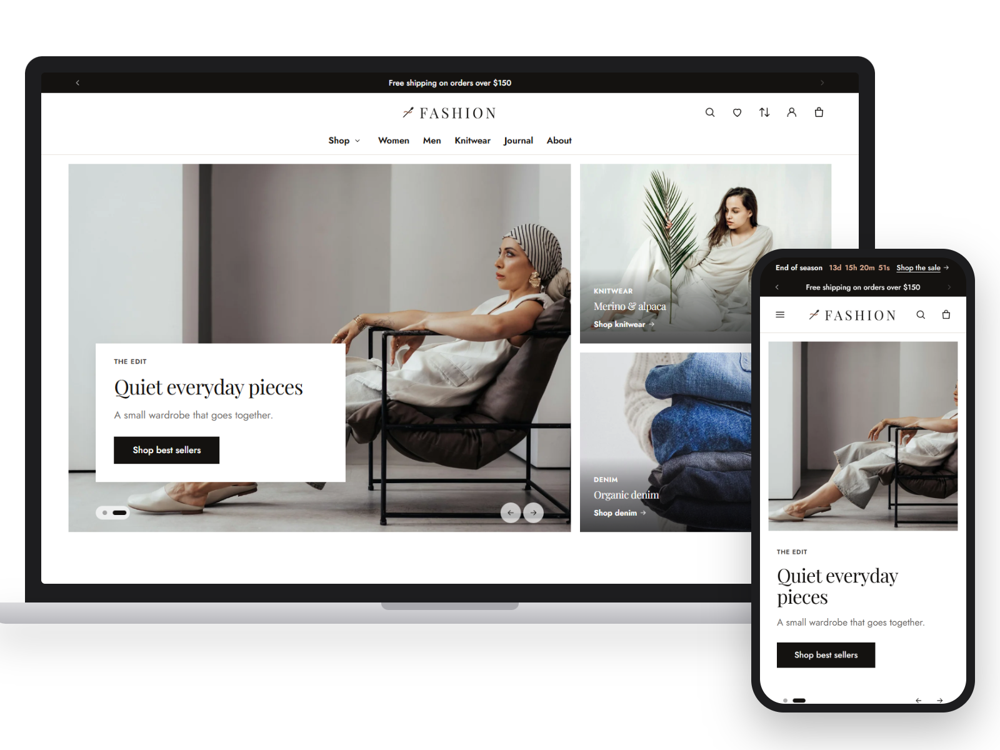 Thread — fashion | 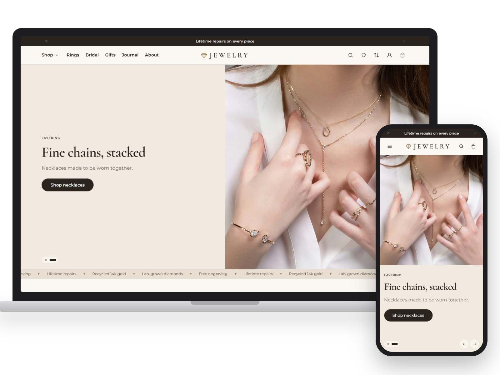 Lustre — jewelry | 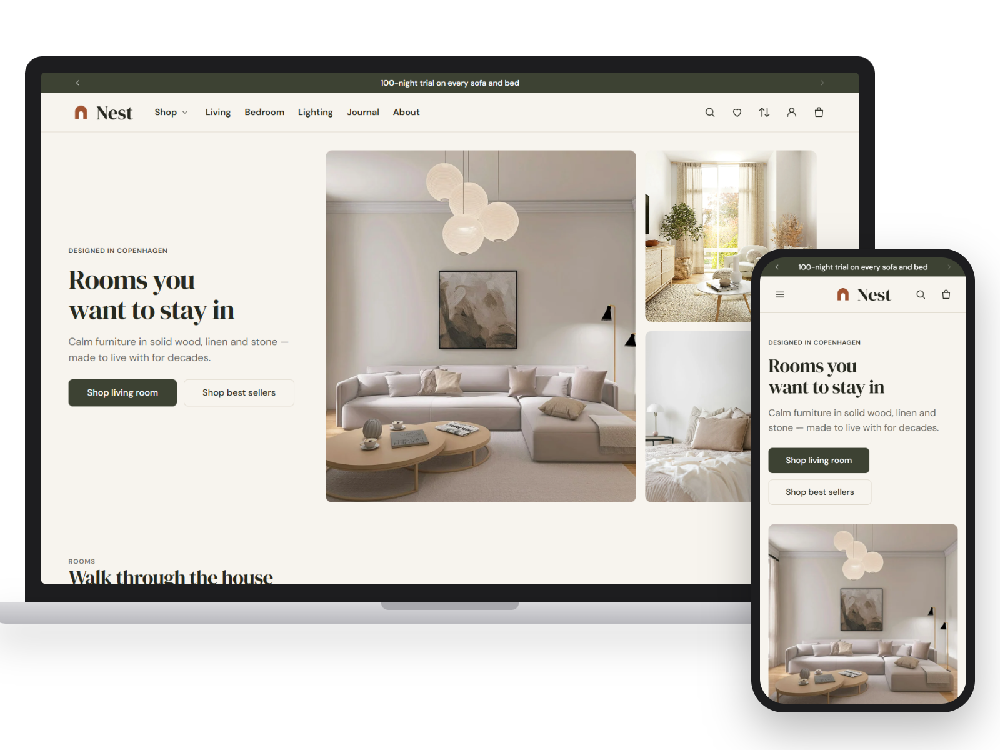 Nest — furniture |

## Stack

Shopify Liquid (Online Store 2.0) · SCSS (Dart Sass) · JavaScript ES modules, web components, esbuild ·
Node.js build server on Render · Claude via the Anthropic API (structured output) · Claude Code ·
Shopify Admin API and CLI · Playwright · ffmpeg

## About

A solo portfolio project by Oleh Pavlushenko. Not on sale; downloads from the configurator are
currently by invitation.

Music in the walkthrough: “Wallpaper” by Kevin MacLeod (incompetech.com), licensed under CC BY 4.0.
